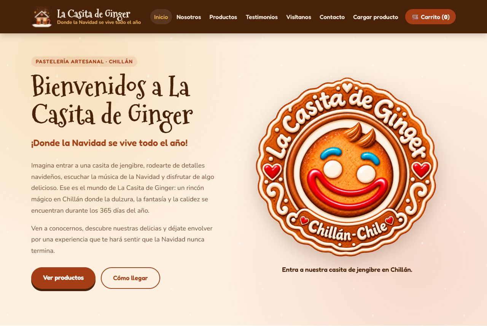
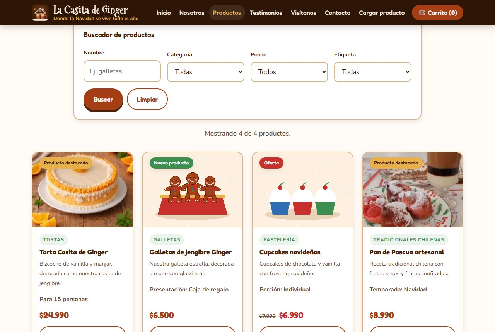
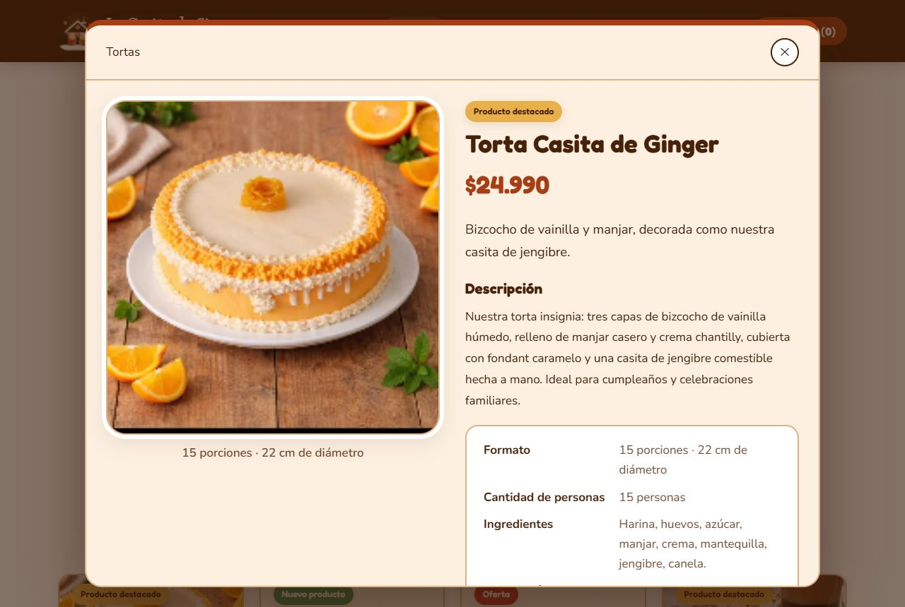
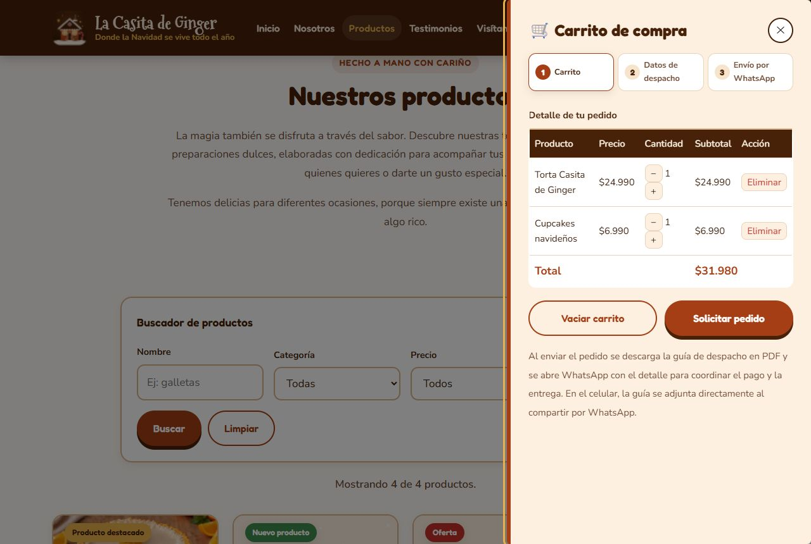
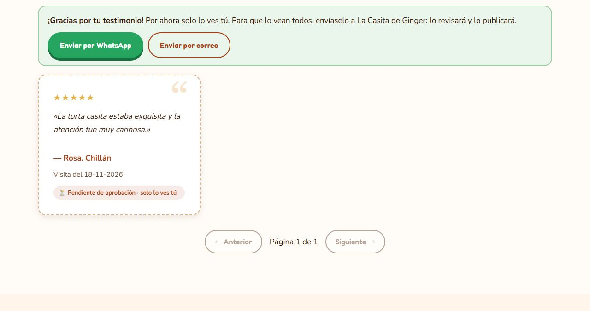
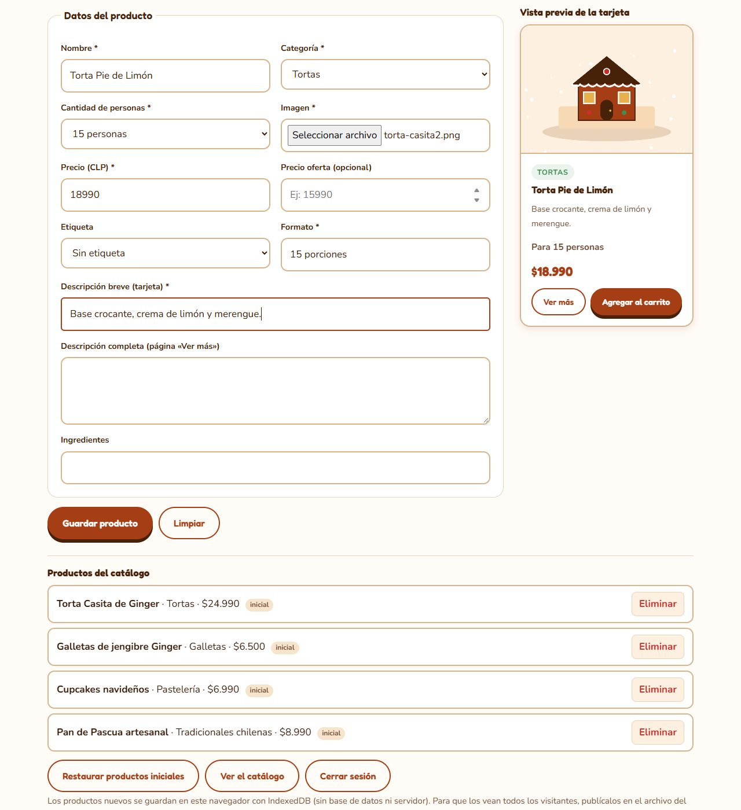
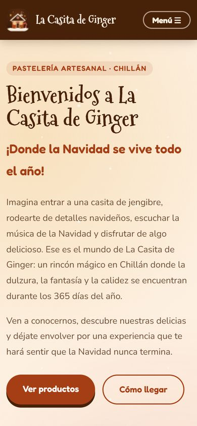

# 🏠🍪 La Casita de Ginger

**Sitio web de una pastelería temática de Chillán donde «la Navidad se vive todo el año».**

| | |
|---|---|
| 🌐 **Sitio en Netlify** | **[https://la-casita-de-ginger-ug7n.netlify.app](https://la-casita-de-ginger-ug7n.netlify.app)** |
| 📁 **Repositorio** | **[https://github.com/adbagan/La_Casita_de_Ginger](https://github.com/adbagan/La_Casita_de_Ginger)** |
| 🎓 **Asignatura** | Diseño Web · 2026-4B-DISEÑO WEB/400-CED-QM · IPLA |
| 👤 **Integrante** | Adán González Barragán |
| 👩‍🏫 **Docente** | Carolina Desiree Tapia Bahamonde |



---

## 📌 Descripción del proyecto

**La Casita de Ginger** es un emprendimiento de Chillán (Región de Ñuble) inspirado en las casitas de galletas de jengibre. Ofrece tortas, galletas, pastelería y preparaciones tradicionales chilenas en un local decorado con motivos navideños durante los 365 días del año. Su personaje es **Ginger**, una galletita de jengibre.

El sitio se desarrolló de forma progresiva durante la asignatura:

| Etapa | Resultado |
|---|---|
| Evaluación 1 | Estructura del sitio con HTML semántico, boceto, maqueta y mapa de navegación |
| Evaluación 2 | Hoja de estilos propia, recorrido de compra, catálogo con filtros, carrito, testimonios y «Cargar producto» |
| Evaluación 3 | Migración al template profesional **Agency** (Bootstrap 5), funcionalidades JavaScript y eventos |
| Examen | Versión final publicada en **GitHub** y **Netlify** |

## 🎯 Objetivos

- Presentar el emprendimiento, su historia, su personaje y su ubicación.
- Mostrar el catálogo de productos con filtros y permitir **armar un pedido** que se envía por **WhatsApp** con una **guía de despacho en PDF**.
- Recibir **consultas por correo**, **testimonios** con puntuación y **comentarios** de cada producto.
- Permitir que la emprendedora **cargue sus propios productos** con foto desde su computador, **sin base de datos**.
- Funcionar bien en **celular, tablet y computador**.

## 🛠️ Tecnologías

| Tecnología | Uso |
|---|---|
| **HTML5** | Estructura semántica: `header`, `nav`, `main`, `section`, `article`, `aside`, `footer`, `figure`, formularios accesibles |
| **CSS3** | Hoja de la marca `css/ginger.css` (variables, grid, flexbox, animaciones, diseño adaptable) |
| **Bootstrap 5.2.3** | Menú, ventanas (modal), panel lateral del carrito (offcanvas) y menú de celular (collapse) |
| **Template Agency 7.0.12** (Start Bootstrap, licencia MIT) | Base visual profesional: menú fijo que se achica, portada y secciones |
| **JavaScript** (sin frameworks) | Todas las funcionalidades del sitio |
| **IndexedDB y File System Access API** | Guardar y publicar productos sin base de datos |
| **Git, GitHub y Netlify** | Control de versiones, repositorio público y despliegue |

Todo funciona **sin servidor y sin librerías externas en línea**: Bootstrap está incluido en el proyecto y la guía en PDF se genera con JavaScript propio.

## ✨ Funcionalidades (JavaScript)

| # | Funcionalidad | Archivo |
|---|---|---|
| 1 | **Catálogo** en matriz de 4 × 2 con páginas y filtros por nombre, categoría, precio, etiqueta y un filtro propio de cada categoría (por ejemplo, personas en tortas) | `js/main.js`, `js/productos.js` |
| 2 | **Carrito de compra**: agregar, cambiar cantidades, subtotales y total; se conserva entre páginas | `js/main.js` |
| 3 | **Pedido por WhatsApp** en 3 pasos, con validación de los datos de despacho y **guía en PDF** | `js/main.js`, `js/guia-despacho.js` |
| 4 | **Detalle del producto** en una ventana, con comentarios en la misma ventana | `js/main.js` |
| 5 | **Testimonios** con 1 a 5 estrellas, ordenados por fecha y con promedio | `js/main.js` |
| 6 | **Cargar producto** protegido con clave: formulario con vista previa de la tarjeta, eliminar y restaurar | `js/main.js` |
| 7 | **Catálogo sin base de datos**: los productos se guardan en el navegador (IndexedDB) y se publican en el archivo `js/catalogo-datos.js` | `js/almacen-catalogo.js` |
| 8 | **Testimonios y comentarios moderados**: el cliente los envía por WhatsApp o correo con un código y la emprendedora los aprueba antes de publicarlos | `js/main.js` |
| 9 | **Consulta por correo** a la emprendedora y **menú del template** (se achica al bajar y marca la sección visible) | `js/main.js`, `js/agency.js` |

## 🖱️ Eventos utilizados

| Evento | Dónde |
|---|---|
| `click` | Agregar al carrito, Ver más, + / − / eliminar, Solicitar pedido, paginación, botones de «Cargar producto», «Enviar por WhatsApp / correo» de las opiniones y opciones del menú en celular |
| `submit` | Buscador, pedido, testimonio, comentario, clave, nuevo producto y consulta (con `preventDefault` y validación) |
| `change` | Filtros, estrellas, tipo de entrega, foto del producto e «Importar catálogo» |
| `input` | Búsqueda mientras se escribe y vista previa de la tarjeta |
| `reset` | Limpiar el buscador y el formulario de productos |
| `scroll` | Menú que se achica y sección marcada en el menú |
| `keydown` (Esc) | Cerrar ventanas y el carrito |
| `shown.bs.modal` / `hidden.bs.modal` | Eventos de Bootstrap: foco en el formulario y paso del detalle al carrito |
| `DOMContentLoaded` | Iniciar cada funcionalidad cuando la página está lista |

## 📂 Estructura del proyecto

```
├── index.html              Inicio: portada, Ginger, quiénes somos, experiencia, testimonios, visítanos y contacto
├── productos.html          Catálogo con filtros y detalle del producto en ventana
├── producto.html           Ficha del producto (respaldo sin JavaScript)
├── cargar-producto.html    Administración del catálogo, protegida con clave
├── 404.html                Página «no encontrada» que muestra Netlify
├── netlify.toml            Configuración del despliegue en Netlify
├── README.md
├── css/
│   ├── agency.css          Template Agency (incluye Bootstrap 5.2.3)
│   └── ginger.css          Estilos de la marca (se carga después del template)
├── js/
│   ├── bootstrap.bundle.min.js
│   ├── agency.js           Script del template (menú)
│   ├── productos.js        Productos iniciales y filtros
│   ├── catalogo-datos.js   Catálogo publicado (reemplaza a la base de datos)
│   ├── almacen-catalogo.js IndexedDB y publicación del catálogo
│   ├── guia-despacho.js    Guía de despacho en PDF
│   └── main.js             Funcionalidades del sitio
├── img/                    Logo, Ginger, equipo, escena navideña y productos por categoría
└── docs/capturas/          Capturas usadas en este README
```

## 📸 Capturas

| Catálogo con filtros | Detalle del producto |
|---|---|
|  |  |
| **Carrito y pedido** | **Testimonio pendiente de aprobación** |
|  |  |
| **Cargar producto** | **Vista en celular** |
|  |  |

## 🚀 Cómo usar el sitio

**Clientes**
1. Revisar el catálogo en **Productos**, filtrar y abrir **Ver más** para ver la ficha y los comentarios.
2. Agregar productos al **Carrito**, presionar **Solicitar pedido**, completar los datos y **Enviar pedido por WhatsApp** (se descarga la guía en PDF).
3. Dejar un **testimonio** o **comentario** y enviarlo a la emprendedora con el botón de WhatsApp o correo.

**Emprendedora («Cargar producto»)**
1. Entrar a **Cargar producto** con la clave de demostración `Ginger123$`.
2. Completar los datos, elegir la foto desde el computador y presionar **Guardar producto**.
3. Pegar los mensajes de testimonios y comentarios recibidos, **Revisar** y **Aprobar**.
4. Publicar con **Guardar en la carpeta del sitio** (Chrome o Edge) o **Descargar catálogo** (copiar `catalogo-datos.js` en `js/`).
5. Subir los cambios a GitHub: Netlify actualiza el sitio automáticamente.

> ⚠️ La clave `Ginger123$` es de demostración. Como el sitio no tiene servidor, queda en `js/main.js` (`CLAVE_CARGA`); para el uso real conviene cambiarla.

## 💻 Ejecutar en el computador

No necesita instalación: basta abrir `index.html` en el navegador.
Para probarlo como en Netlify (con `http`), se puede usar un servidor local, por ejemplo:

```bash
python -m http.server 8080
```

y abrir `http://localhost:8080`.

## 🌐 Despliegue en Netlify

1. En [app.netlify.com](https://app.netlify.com) elegir **Add new site → Import an existing project → GitHub** y seleccionar este repositorio.
2. Dejar **Build command** vacío y **Publish directory** en `.` (ya está indicado en `netlify.toml`).
3. Presionar **Deploy**. Cada vez que se suben cambios a GitHub, Netlify publica la nueva versión.

## ✅ Pruebas

El sitio se verificó con **180 pruebas automáticas** (Chrome + Puppeteer) en 7 grupos: catálogo, testimonios, compra y contacto, detalle en ventana, template e integración, catálogo sin base de datos y opiniones moderadas. También se revisaron todos los enlaces y el diseño en 375, 768 y 1280 px de ancho, sin errores de JavaScript.

## 👤 Integrante y aporte individual

| Integrante | Aporte |
|---|---|
| **Adán González Barragán** | Desarrollo completo del proyecto: análisis del emprendimiento, boceto, maqueta y mapa de navegación; estructura HTML; hoja de estilos de la marca; migración al template Agency; todas las funcionalidades JavaScript y sus eventos; catálogo y opiniones sin base de datos; pruebas; repositorio en GitHub, despliegue en Netlify, documentación y video. |

## 📄 Créditos y licencia

- Template **Agency** de [Start Bootstrap](https://startbootstrap.com/theme/agency) (licencia MIT) y **Bootstrap 5.2.3** (licencia MIT).
- Tipografías **Fredoka**, **Mountains of Christmas** y **Nunito** de Google Fonts.
- Contenido, imágenes y marca: **La Casita de Ginger**, Chillán, Chile. Proyecto académico IPLA 2026.
